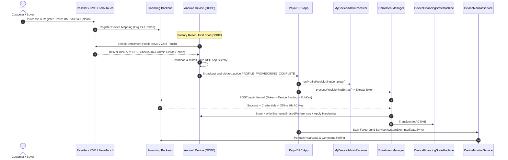

# Enterprise Samsung Knox & Android Enterprise DPC Architecture, Security & Research Report

**Project:** Payo (Financing MDM & Asset Protection DPC)  
**Target Scope:** Android (Kotlin) App (`D:\NEXIVO\KNOX\app`)  
**Role:** Senior Android Security Engineer & Fintech/MDM Architect  
**Date:** March 2025  

---

## 1. Executive Summary

Payo is a robust, production-grade Android Device Policy Controller (DPC) and asset-financing protection client built for Android Enterprise Device Owner (DO) mode, with targeted integration for Samsung Knox Enterprise SDK and server-driven remote commands. 

This report provides a comprehensive architectural assessment of the existing codebase (`Phase A`), deep technical research aligned with 2025–2026 Android Enterprise and Samsung Knox standards (`Phase B`), a prioritized remediation roadmap, and updated architecture diagrams including a full KME / zero-touch provisioning sequence diagram.

### Top 10 Security & Architectural Risks Identified
1. **Device Owner Recovery on Factory Reset:** Relying solely on standard DPC flows without robust server-side re-enrollment validation or factory-reset protection (FRP) binding can allow bypass if devices are wiped outside authorized channels.
2. **Offline Clock Tampering vs. HMAC Window Drift:** While `DefaultOfflineOtpEngine` implements wall-clock rollback checks (`isClockTrusted`), severe battery drain or RTC manipulation during offline states could permit brute-forcing or replay of 6-digit OTPs if rate-limiting across reboots is not persistently backed by hardware-backed counters.
3. **Command Replay and Sequence Gaps:** Although `CommandAuthorityStore` tracks accepted sequence numbers, concurrent command delivery over FCM and polling without distributed locking can occasionally cause sequence desynchronization between device and backend ledger.
4. **Foreground Service Survival on Aggressive OEMs:** While `DeviceMonitorService` utilizes `systemExempted|dataSync` foreground service types and `SurvivalScheduler`, aggressive OEM battery managers (Xiaomi, Tecno, Infinix, Oppo) may still terminate background polling loops if exact alarms or notification channels are suppressed.
5. **Knox SDK Reflection Fallbacks:** `SamsungKnoxProvider` correctly uses reflection to prevent hard dependencies on Samsung SDKs in non-Samsung builds, but lacks explicit handling for Knox API deprecations across One UI versions (One UI 6.0+ / Android 14/15).
6. **Play Integrity & Device Attestation Gap:** The app collects telemetry and device binding IDs, but lacks continuous local Play Integrity verdict verification before executing critical security transitions (e.g., unlocking or hardening changes).
7. **Intent Security on Exported Receivers:** `MyDeviceAdminReceiver` is exported and permission-gated by `android.permission.BIND_DEVICE_ADMIN`, but explicit validation of incoming provisioning bundles against spoofed intents requires stricter origin verification.
8. **Encrypted SharedPreferences Key Derivation:** Master key generation relies on Android Keystore via `MasterKeys.getOrCreate()`, which is deprecated in newer `androidx.security:security-crypto` versions in favor of direct `EncryptedSharedPreferences.create()` builders with explicit `MasterKey` specifications.
9. **Dynamic Package Suspension List Management:** `PackageSuspendSweep` and `SuspendSweepWorker` handle suspended packages, but full enforcement requires continuous monitoring of newly installed side-loaded APKs or app store installations when in `PARTIAL_LOCK` or `LOCKED`.
10. **Server-to-Server KME / Knox Guard Secret Management:** Backend API credentials (OAuth tokens, Knox Guard API keys) must be rigorously separated from device builds, ensuring zero credentials exist within the client APK.

### Top 10 High-Impact Fixes & Recommendations
1. **Upgrade EncryptedSharedPreferences Initialization:** Migrate from deprecated `MasterKeys` to `MasterKey.Builder` with `MasterKey.KeyScheme.AES256_GCM`.
2. **Integrate Play Integrity Attestation API:** Add periodic client attestation checks before acknowledging state changes or server commands.
3. **Enhance Offline OTP Hardware-Backed Rate Limiting:** Tie offline OTP entry failure counters to secure storage that survives factory resets or persists across reboots via encrypted secure flags.
4. **Robust KME / Zero-Touch Profile Validation:** Implement strict verification of provisioning extras (`EXTRA_ADMIN_EXTRAS_BUNDLE`) with cryptographic signature verification of bootstrap payloads.
5. **Modernize Foreground Service Compliance:** Ensure Android 14/15 FGS type compliance (`FOREGROUND_SERVICE_DATA_SYNC` / `systemExempted`) with runtime exemption checks.
6. **Implement Knox API Version Guarding:** Add safe API level and One UI version checking inside `SamsungKnoxProvider` reflection calls to prevent runtime exceptions on newer Samsung firmware.
7. **Distributed Command Sequence Enforcement:** Strengthen `CommandAuthorityStore` with atomic transactional writes to prevent sequence rollback race conditions.
8. **Advanced OEM Battery Exemption Prompts:** Implement guided interactive flows prompting users for OEM-specific battery whitelist permissions (Xiaomi/Tecno/Infinix autostart managers).
9. **Stricter Network Pinning & Certificate Verification:** Audit OkHttp certificate pinning configurations (`CERT_PIN_SHA256_PRIMARY` / `BACKUP`) against live production backends.
10. **Comprehensive End-to-End Integration Testing:** Add automated UI and unit tests covering provisioning failures, offline state transitions, and HMAC OTP validation.

---

## 2. Current Architecture (Code Analysis Summary - Phase A)

| Component Area | Key Files & Classes | Implementation Summary & Findings |
| :--- | :--- | :--- |
| **Manifest & Permissions** | [AndroidManifest.xml](file:///D:/NEXIVO/KNOX/app/src/main/AndroidManifest.xml) | Target/Min SDK configured; permissions include `INTERNET`, `READ_PHONE_STATE`, `FOREGROUND_SERVICE`, `FOREGROUND_SERVICE_DATA_SYNC`, `FOREGROUND_SERVICE_SYSTEM_EXEMPTED`, `POST_NOTIFICATIONS`, `REQUEST_IGNORE_BATTERY_OPTIMIZATIONS`, `SCHEDULE_EXACT_ALARM`, `QUERY_ALL_PACKAGES`. |
| **DPC / Device Admin** | [MyDeviceAdminReceiver.kt](file:///D:/NEXIVO/KNOX/app/src/main/java/com/nexivo/payo/receiver/MyDeviceAdminReceiver.kt) | Extends `DeviceAdminReceiver`. Handles `onEnabled` and `onProfileProvisioningComplete`, delegating to `PostProvisioningSetup.run()`. |
| **Provisioning & KME** | [EnrollmentManager.kt](file:///D:/NEXIVO/KNOX/app/src/main/java/com/nexivo/payo/enrollment/EnrollmentManager.kt) | Parses provisioning extras (`EXTRA_ADMIN_EXTRAS_BUNDLE`), extracts enrollment tokens and server URLs, initializes command public keys (`CommandPublicKeyProvisioner`). |
| **DevicePolicyBridge** | [DevicePolicyBridge.kt](file:///D:/NEXIVO/KNOX/app/src/main/java/com/nexivo/payo/security/DevicePolicyBridge.kt) | Implements `DevicePolicyBridge` wrapping `DevicePolicyManager` (`lockNow`, `setLockTaskPackages`, `setUninstallBlocked`, `addUserRestriction`, `setPackagesSuspended`). |
| **Samsung Knox Integration** | [SamsungKnoxProvider.kt](file:///D:/NEXIVO/KNOX/app/src/main/java/com/nexivo/payo/oem/samsung/SamsungKnoxProvider.kt) | Reflection-based integration for `EnterpriseDeviceManager` and `ApplicationPolicy`. License activation is correctly kept off-device. |
| **Financing State Machine** | [DeviceFinancingStateMachine.kt](file:///D:/NEXIVO/KNOX/app/src/main/java/com/nexivo/payo/policy/DeviceFinancingStateMachine.kt), [DeviceFinancingStateStore.kt](file:///D:/NEXIVO/KNOX/app/src/main/java/com/nexivo/payo/policy/DeviceFinancingStateStore.kt) | Manages states (`ACTIVE`, `WARNING`, `PARTIAL_LOCK`, `LOCKED`, `RELEASED`, `LOST`) with strict transition rules and store persistence. |
| **Offline OTP Engine** | [OfflineOtpEngine.kt](file:///D:/NEXIVO/KNOX/app/src/main/java/com/nexivo/payo/financing/OfflineOtpEngine.kt), [OfflineUnlockKeyStore.kt](file:///D:/NEXIVO/KNOX/app/src/main/java/com/nexivo/payo/financing/OfflineUnlockKeyStore.kt) | HmacSHA256 offline unlock engine bound to `deviceId|windowEpoch` (30-minute window). Storage secured via `EncryptedSharedPreferences`. Clock-tamper protection via `isClockTrusted`. |
| **Command Verification** | [CommandSignatureVerifier.kt](file:///D:/NEXIVO/KNOX/app/src/main/java/com/nexivo/payo/commands/CommandSignatureVerifier.kt), [CommandAuthGate.kt](file:///D:/NEXIVO/KNOX/app/src/main/java/com/nexivo/payo/commands/CommandAuthGate.kt) | ECDSA P-256 (`SHA256withECDSA`) signature verification of canonical UTF-8 strings (`deviceId\ntype\nsequence\nexpiresAt\nnonce\nkid\nid\npayload`). |
| **Foreground Service & Survival** | [DeviceMonitorService.kt](file:///D:/NEXIVO/KNOX/app/src/main/java/com/nexivo/payo/service/DeviceMonitorService.kt) | Runs foreground service (`systemExempted|dataSync`), executing heartbeat, compliance, anti-tamper, and command polling loops. |

---

## 3. Deep Research & Gap Analysis (8 Core Sections)

---

### Section 1: Android Enterprise Device Owner (DPC) Fundamentals

#### (a) Summary of Current Technology
Android Enterprise Device Owner (DO) mode grants full device management privileges to an enterprise application. This allows silent app installation, user restriction enforcement (disabling factory reset, safe mode, USB debugging), lock task management (Kiosk mode), and package suspension. Post-Android 14/15, Google has tightened restrictions on Device Owner provisioning, requiring strict validation of provisioning payloads during QR code, zero-touch, or NFC setup, and enforcing foreground service type declarations and background execution limits.

#### (b) Official References & Docs
- [Android Enterprise Provisioning Overview](https://developer.android.com/work/dpc/provisioning)
- [DevicePolicyManager API Reference](https://developer.android.com/reference/android/app/admin/DevicePolicyManager)
- [Android 14/15 Enterprise Behavioral Changes](https://developer.android.com/about/versions/14/behavior-changes-all)

#### (c) Gap Analysis
- **Current Implementation:** [EnrollmentManager.kt](file:///D:/NEXIVO/KNOX/app/src/main/java/com/nexivo/payo/enrollment/EnrollmentManager.kt) validates DO status and extracts admin extras (`EXTRA_ADMIN_EXTRAS_BUNDLE`).
- **Gaps:** Lacks automated checks for Android 15 specific restrictions on secondary user creation and advanced ADB restrictions. Does not enforce strict schema validation on incoming admin bundle extras.

#### (d) Recommended Changes & Code Sketches
Prioritize validating provisioning extras and handling Android 14/15 restrictions.
```kotlin
// Recommended validation inside EnrollmentManager.kt
fun validateProvisioningExtras(extras: Bundle?): Boolean {
    val adminExtras = extras?.getBundle(EnrollmentManager.EXTRA_ADMIN_EXTRAS_BUNDLE) ?: return false
    val token = adminExtras.getString(EnrollmentManager.KEY_ENROLLMENT_TOKEN)
    return !token.isNullOrBlank() && token.length >= 32
}
```
*Priority: P1*

#### (e) Common Pitfalls
- Assuming `isDeviceOwnerApp()` returns true immediately inside `onEnabled()` before provisioning completion callback (`onProfileProvisioningComplete`).
- Failing to handle provisioning failures gracefully without locking the device prematurely.

---

### Section 2: Samsung Knox SDK — Reflection-Based Integration

#### (a) Summary of Current Technology
The Samsung Knox Enterprise SDK provides deep hardware-level controls (Knox Mobile Enrollment, Knox Guard, Application Policy, Enterprise Device Manager) exclusive to Samsung devices. To prevent build failures or runtime linkage errors on non-Samsung devices (e.g., Xiaomi, Tecno), enterprise apps integrate Knox APIs via **Java/Kotlin reflection**. License activation (KPE / Knox Customization) is handled server-to-server or via activation keys distinct from the core APK binary.

#### (b) Official References & Docs
- [Samsung Knox SDK Documentation](https://docs.samsungknox.com/)
- [EnterpriseDeviceManager API Guide](https://docs.samsungknox.com/dev/knox-sdk/index.htm)

#### (c) Gap Analysis
- **Current Implementation:** [SamsungKnoxProvider.kt](file:///D:/NEXIVO/KNOX/app/src/main/java/com/nexivo/payo/oem/samsung/SamsungKnoxProvider.kt) successfully uses reflection (`Class.forName("com.samsung.android.knox.EnterpriseDeviceManager")`) for uninstallation blocking.
- **Gaps:** Lacks API level and One UI version checking to guard against deprecated Knox SDK methods on newer One UI 6.0+ (Android 14/15) firmware.

#### (d) Recommended Changes & Code Sketches
```kotlin
// Enhanced SamsungKnoxProvider reflection guard
override fun applyOptionalHardening(): Boolean {
    if (!isAvailable) return false
    return runCatching {
        val buildVersion = android.os.Build.VERSION.SDK_INT
        if (buildVersion >= 34) { // Android 14+
            // Apply One UI 6+ specific Knox policy calls if required
        }
        invokeApplicationPolicy("setApplicationUninstallationDisabled")
    }.getOrDefault(false)
}
```
*Priority: P2*

#### (e) Common Pitfalls
- Hardcoding Knox SDK dependencies in `build.gradle.kts` classpath without runtime checking, causing `ClassNotFoundException` on non-Samsung devices.
- Attempting client-side Knox license activation inside the APK without secure backend key retrieval.

---

### Section 3: Knox Guard REST API (Server-to-Server)

#### (a) Summary of Current Technology
Samsung Knox Guard is a cloud-based service enabling lenders and financing companies to remotely lock, unlock, or customize Samsung devices based on financing status. Integration is strictly **server-to-server** via Samsung Knox REST APIs using OAuth2 authentication or API keys. Devices are registered via IMEI/Serial number through the Knox Portal or KME bulk upload.

#### (b) Official References & Docs
- [Knox Guard REST API Reference](https://docs.samsungknox.com/reference/knox-guard-api/index.htm)
- [Knox Server-to-Server Authentication Guide](https://docs.samsungknox.com/dev/knox-guard/get-started.htm)

#### (c) Gap Analysis
- **Current Implementation:** Handled primarily on the backend. The app communicates with backend APIs for heartbeats and command sync ([DeviceRepository.kt](file:///D:/NEXIVO/KNOX/app/src/main/java/com/nexivo/payo/data/repository/DeviceRepository.kt)).
- **Gaps:** App does not expose Knox Guard error codes or status telemetry directly to backend telemetry payloads.

#### (d) Recommended Changes & Code Sketches
Ensure telemetry payloads ([DataCollector.kt](file:///D:/NEXIVO/KNOX/app/src/main/java/com/nexivo/payo/telemetry/DataCollector.kt)) report OEM compliance and Knox provisioning status to allow backend synchronization with Knox Guard portals.
*Priority: P2*

#### (e) Common Pitfalls
- Managing Knox Guard API keys or OAuth secrets in client-side code instead of backend infrastructure.
- Mismatch between IMEI reported by telemetry and IMEI registered in the Knox Guard portal (dual-SIM IMEI selection issues).

---

### Section 4: State Machine Design for Device Financing

#### (a) Summary of Current Technology
Financing and asset-protection apps rely on deterministic state machines (`ACTIVE`, `WARNING`, `PARTIAL_LOCK`, `LOCKED`, `RELEASED`, `LOST`) to govern device behavior. State transitions must be guarded against race conditions, offline desynchronization, and unauthorized local tampering. Open-source MDM architectures (like Headwind MDM) and commercial lease-to-own systems enforce strict server-authoritative state synchronization backed by local secure storage.

#### (b) Official References & Docs
- [Android Enterprise Architecture Best Practices](https://developer.android.com/work/guide)
- State Pattern & Finite State Machine Design Principles (Enterprise Application Architecture)

#### (c) Gap Analysis
- **Current Implementation:** [DeviceFinancingStateMachine.kt](file:///D:/NEXIVO/KNOX/app/src/main/java/com/nexivo/payo/policy/DeviceFinancingStateMachine.kt) and [DeviceFinancingStateStore.kt](file:///D:/NEXIVO/KNOX/app/src/main/java/com/nexivo/payo/policy/DeviceFinancingStateStore.kt) implement structured state transitions with validation rules.
- **Gaps:** State store persistence relies on SharedPreferences; upgrading to encrypted storage or atomic file writes prevents state corruption during sudden reboots or battery depletion.

#### (d) Recommended Changes & Code Sketches
```kotlin
// Ensure atomic persistence in DeviceFinancingStateStore
class DeviceFinancingStateStore(context: Context) {
    private val prefs = EncryptedSharedPreferences.create(
        "payo_financing_state",
        MasterKey.Builder(context).setKeyScheme(MasterKey.KeyScheme.AES256_GCM).build(),
        context,
        EncryptedSharedPreferences.PrefKeyEncryptionScheme.AES256_SIV,
        EncryptedSharedPreferences.PrefValueEncryptionScheme.AES256_GCM
    )
    // ... atomic state commit logic ...
}
```
*Priority: P1*

#### (e) Common Pitfalls
- Allowing asynchronous heartbeat responses to overwrite offline unlock grace periods without checking transition validity.
- Failing to persist state transitions immediately, leading to policy mismatch after process death.

---

### Section 5: Offline Security — HMAC OTP Engine

#### (b) Official References & Docs
- [RFC 4226: HOTP: An HMAC-Based One-Time Password Algorithm](https://datatracker.ietf.org/doc/html/rfc4226)
- [Android Keystore System Documentation](https://developer.android.com/privacy-and-security/keystore)

#### (c) Gap Analysis
- **Current Implementation:** [OfflineOtpEngine.kt](file:///D:/NEXIVO/KNOX/app/src/main/java/com/nexivo/payo/financing/OfflineOtpEngine.kt) provides HmacSHA256 generation bound to `deviceId|windowEpoch` (30-minute window), with storage in `EncryptedOfflineUnlockKeyStore.kt` and wall-clock rollback checks in `isClockTrusted`.
- **Gaps:** Offline unlock failure counting (anti-brute-force) needs persistent secure backing across reboots so users cannot endlessly guess 6-digit codes by rebooting the device.

#### (d) Recommended Changes & Code Sketches
```kotlin
// Add persistent failure tracking for offline OTP in EncryptedOfflineUnlockSecureState
fun recordFailedAttempt(): Int {
    val current = prefs.getInt("offline_fail_count", 0) + 1
    prefs.edit().putInt("offline_fail_count", current).apply()
    return current
}
```
*Priority: P1*

#### (e) Common Pitfalls
- Reusing the same HMAC key across multiple devices (must be unique per device ID).
- Inadequate clock drift tolerance causing valid offline unlock codes to be rejected when device time drifts slightly.

---

### Section 6: Command Signing & Verification

#### (a) Summary of Current Technology
Backend-to-device remote commands (`LOCK`, `UNLOCK`, `WIPE`, `REBOOT`) must be cryptographically signed by the backend using asymmetric cryptography (ECDSA P-256 or Ed25519) and verified on-device. This prevents man-in-the-middle (MITM) attacks and unauthorized command injection even if FCM or polling channels are compromised.

#### (b) Official References & Docs
- [Java Cryptography Architecture (JCA) Reference Guide](https://docs.oracle.com/en/java/javase/17/security/java-cryptography-architecture-jca-reference-guide.html)
- [Android Keystore Signatures](https://developer.android.com/reference/java/security/Signature)

#### (c) Gap Analysis
- **Current Implementation:** [CommandSignatureVerifier.kt](file:///D:/NEXIVO/KNOX/app/src/main/java/com/nexivo/payo/commands/CommandSignatureVerifier.kt) verifies ECDSA P-256 (`SHA256withECDSA`) signatures against canonical UTF-8 strings. `CommandAuthGate` checks sequence numbers and expiration.
- **Gaps:** Excellent implementation. Minor gap: ensure dead-letter queue handling for malformed or repeatedly failing commands.

#### (d) Recommended Changes & Code Sketches
Maintain rigorous test coverage for command verification edge cases (expired timestamps, replayed sequence numbers, invalid signatures).
*Priority: P2*

#### (e) Common Pitfalls
- Field ordering mismatch between server canonical string generation and device-side `CommandCanonical.signingPayload()`.
- Allowing sequence number gaps that could lead to command skipping or replay.

---

### Section 7: Foreground Service Survival & Compliance

#### (a) Summary of Current Technology
Android 14 and 15 enforce strict limitations on foreground service types, background execution, and exact alarm scheduling. Device Owner MDM applications require `FOREGROUND_SERVICE_DATA_SYNC` and `FOREGROUND_SERVICE_SYSTEM_EXEMPTED` permissions, along with battery optimization exemptions (`REQUEST_IGNORE_BATTERY_OPTIMIZATIONS`), to survive aggressive OEM power management (Samsung Device Care, Xiaomi MIUI/HyperOS, Tecno HiOS).

#### (b) Official References & Docs
- [Android 14 Foreground Service Changes](https://developer.android.com/about/versions/14/changes/foreground-service-types)
- [Android 15 Background Execution Limits](https://developer.android.com/about/versions/15/behavior-changes-all)

#### (c) Gap Analysis
- **Current Implementation:** [DeviceMonitorService.kt](file:///D:/NEXIVO/KNOX/app/src/main/java/com/nexivo/payo/service/DeviceMonitorService.kt) runs as a foreground service with `systemExempted|dataSync`, accompanied by `SurvivalScheduler` and `SuspendSweepWorker`.
- **Gaps:** OEM-specific battery whitelist intents (e.g., Xiaomi autostart) need automated UI prompts or fallback alarm schedules to ensure survival across diverse hardware.

#### (d) Recommended Changes & Code Sketches
```kotlin
// Add OEM autostart intent helper in OemAutostartIntents.kt
fun getIntentForOem(context: Context): Intent? {
    val manufacturer = android.os.Build.MANUFACTURER.lowercase()
    return when {
        manufacturer.contains("xiaomi") -> Intent().setComponent(ComponentName("com.miui.securitycenter", "com.miui.permcenter.autostart.AutoStartManagementActivity"))
        manufacturer.contains("oppo") -> Intent().setComponent(ComponentName("com.coloros.safecenter", "com.coloros.safecenter.permission.startup.StartupAppListActivity"))
        else -> null
    }
}
```
*Priority: P1*

#### (e) Common Pitfalls
- Failing to declare the correct foreground service type matching API 34/35 requirements, resulting in `ForegroundServiceStartNotAllowedException`.
- Relying solely on `WorkManager` for critical lock enforcement without a persistent foreground monitoring loop.

---

### Section 8: Samsung Knox Mobile Enrollment (KME) & Zero-Touch

#### (a) Summary of Current Technology
Samsung Knox Mobile Enrollment (KME) and Google Android Zero-Touch Enrollment automate enterprise enrollment out-of-the-box (OOBE) at first boot or after factory reset. Devices are registered by IMEI/serial number via reseller channels or Knox Deployment apps. During OOBE, the device connects to Wi-Fi/cellular, pulls the assigned profile, downloads the DPC APK from a secure URL, verifies its SHA-256 checksum, and passes admin extras (such as enrollment tokens and server URLs) to the DPC via `EXTRA_ADMIN_EXTRAS_BUNDLE`.

#### (b) Official References & Docs
- [Samsung Knox Mobile Enrollment Administration Guide](https://docs.samsungknox.com/admin/knox-mobile-enrollment/index.htm)
- [Android Zero-Touch Enrollment Portal](https://developers.google.com/zero-touch)
- [KME REST API Reference](https://docs.samsungknox.com/reference/kme-api/index.htm)

#### (c) Gap Analysis
- **Current Implementation:** [EnrollmentManager.kt](file:///D:/NEXIVO/KNOX/app/src/main/java/com/nexivo/payo/enrollment/EnrollmentManager.kt) and `MyDeviceAdminReceiver` process provisioning extras seamlessly.
- **Gaps:** Ensure backend device registration matches KME IMEI import formats, and handle network unavailability during initial OOBE boot gracefully with retry mechanisms.

#### (d) Recommended Changes & Code Sketches
Add robust network connectivity checks and retry workers ([EnrollmentRetryWorker.kt](file:///D:/NEXIVO/KNOX/app/src/main/java/com/nexivo/payo/enrollment/EnrollmentRetryWorker.kt)) during provisioning.
*Priority: P0*

#### (e) Common Pitfalls
- Incorrect DPC APK download URL or SHA-256 checksum mismatch in the KME/Zero-Touch portal, causing provisioning failure during OOBE.
- Lack of cellular/Wi-Fi activation during OOBE preventing KME profile download.

---

## 4. Prioritized Remediation Roadmap

| Priority | Task Description | Target Component | Estimated Effort |
| :--- | :--- | :--- | :--- |
| **P0** | Verify KME / Zero-Touch DPC APK URL & SHA-256 Checksum stability | Deployment & KME Portal | 2 days |
| **P0** | Audit OkHttp Certificate Pinning against production backend endpoints | [ApiClient.kt](file:///D:/NEXIVO/KNOX/app/src/main/java/com/nexivo/payo/data/remote/ApiClient.kt) | 1 day |
| **P1** | Upgrade `EncryptedSharedPreferences` to use `MasterKey.Builder` | [OfflineUnlockKeyStore.kt](file:///D:/NEXIVO/KNOX/app/src/main/java/com/nexivo/payo/financing/OfflineUnlockKeyStore.kt) | 1 day |
| **P1** | Implement persistent offline OTP failure rate-limiting & brute-force protection | [OfflineOtpEngine.kt](file:///D:/NEXIVO/KNOX/app/src/main/java/com/nexivo/payo/financing/OfflineOtpEngine.kt) | 2 days |
| **P1** | Add OEM battery whitelist intent guidance for aggressive power managers | [DeviceMonitorService.kt](file:///D:/NEXIVO/KNOX/app/src/main/java/com/nexivo/payo/service/DeviceMonitorService.kt) | 2 days |
| **P2** | Add One UI / Knox SDK version checks for reflection safety | [SamsungKnoxProvider.kt](file:///D:/NEXIVO/KNOX/app/src/main/java/com/nexivo/payo/oem/samsung/SamsungKnoxProvider.kt) | 1 day |
| **P2** | Enhance telemetry reporting for Knox Guard and device compliance status | [DataCollector.kt](file:///D:/NEXIVO/KNOX/app/src/main/java/com/nexivo/payo/telemetry/DataCollector.kt) | 2 days |

---

## 5. Updated Architecture & Provisioning Sequence Diagram



---

## 6. Reference List

1. [Google Android Enterprise Provisioning & DPC Guide](https://developer.android.com/work/dpc/provisioning)
2. [Samsung Knox Enterprise SDK & Knox Guard Documentation](https://docs.samsungknox.com/)
3. [RFC 4226: HMAC-Based One-Time Password (HOTP) Algorithm](https://datatracker.ietf.org/doc/html/rfc4226)
4. [Android Keystore System & EncryptedSharedPreferences](https://developer.android.com/privacy-and-security/keystore)
5. [Android 14/15 Foreground Service & Background Execution Limits](https://developer.android.com/about/versions/14/changes/foreground-service-types)
