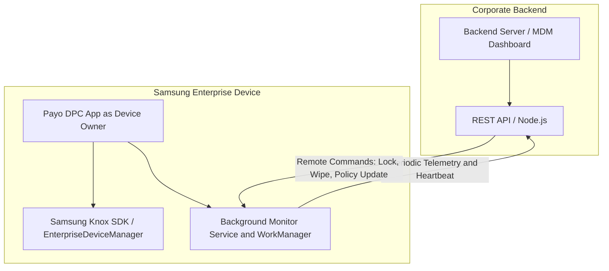

# Enterprise Samsung Knox MDM Solution: Technical Proposal and Presentation Guide

---

## 1. Executive Summary

This document outlines the comprehensive enterprise architecture and implementation plan for upgrading the KNOX (Payo) Mobile Device Management (MDM) solution. Built on top of Android Device Owner and Samsung Knox SDK (following official Samsung Knox Documentation), this solution transforms standard Samsung enterprise devices into fully managed, secure, and remotely controllable corporate assets.

---

## 2. System Architecture and Workflow



---

## 3. Project Prerequisites and Technical Requirements

To successfully deploy and test this Samsung Knox MDM solution, the following requirements must be met:

### A. Hardware and Device Requirements
- Physical Samsung Device: Knox APIs do not work on Android Emulators. A real Samsung Galaxy phone or tablet supporting Samsung Knox (Knox 3.x+) is mandatory.
- Factory Reset State: The test device must be freshly factory reset with no Google accounts or Samsung accounts signed in prior to setting up Device Owner.

### B. Software and SDK Requirements
- Samsung Knox SDK (knoxsdk.aar): Must be downloaded from the Samsung SEAP Portal and placed in the app/libs/ directory.
- Knox License Key (KLM/ELM): A valid enterprise license key from Samsung SEAP.

### C. Infrastructure and Backend
- REST API Endpoints: A backend server providing endpoints for telemetry ingestion (/api/v1/devices/report), heartbeats, and command polling (/api/v1/devices/commands).

### D. Development and Provisioning Tools
- Android Studio and ADB (Android Debug Bridge): Required for building the app and provisioning Device Owner via ADB command:
  ```bash
  adb shell dpm set-device-owner com.example.payo/.receiver.MyDeviceAdminReceiver
  ```

---

## 4. Core Capabilities and Samsung Knox Integration Modules

To achieve 100% compliance and enterprise-grade functionality, the solution encompasses the following core modules:

### A. Knox License Management (KLM / ELM)
- API: com.samsung.android.knox.license.EnterpriseLicenseManager
- Functionality: Activates enterprise trial or commercial licenses using Knox Suite license keys. Listens to license status broadcast intents and handles activation retries.

### B. Advanced Security and Restrictions (RestrictionPolicy)
- API: com.samsung.android.knox.restriction.RestrictionPolicy
- Functionality:
  - Disable USB data transfer and USB debugging when outside secure zones.
  - Restrict screen capture / screenshots to prevent data leaks.
  - Disable mock locations and unknown source APK installations.
  - Control Bluetooth pairing and Wi-Fi state.

### C. Application Management and Silent Installation (ApplicationPolicy)
- API: com.samsung.android.knox.application.ApplicationPolicy
- Functionality:
  - Silent installation and uninstallation of corporate APKs without user intervention.
  - App whitelisting and blacklisting (preventing unauthorized app usage).
  - Silent permission granting for enterprise apps.

### D. Kiosk Mode and Hardware Lockdown (KioskMode)
- API: com.samsung.android.knox.kiosk.KioskMode
- Functionality:
  - Single-app or multi-app dedicated device lockdown.
  - Disabling hardware keys (Home, Back, Recent Apps, Power menu).
  - Locking the status bar and notification shade to restrict user tampering.

### E. Network and Firewall Control (FirewallPolicy)
- API: com.samsung.android.knox.net.firewall.Firewall
- Functionality:
  - Enforce domain/IP filtering rules.
  - Restrict network traffic to approved corporate servers and gateways.

---

## 5. Telemetry and Device Monitoring

The background service (DeviceMonitorService) operates continuously with minimal battery overhead:
- Data Collected: Device identity (IMEI, Serial, Android ID), hardware/OS details, security status (encryption, root detection via Knox warranty bit), network info, battery, and storage.
- Reporting Schedule:
  - Heartbeat: Every 15 minutes.
  - Full Telemetry Report: Every 60 minutes or upon network state changes.
- Remote Command Polling: Pulls instructions from the backend (LOCK, WIPE, REBOOT, INSTALL_APP, UPDATE_POLICY).

---

## 6. Implementation Roadmap

| Phase | Milestone | Description |
| :--- | :--- | :--- |
| Phase 1 | Knox SDK Integration | Replace stubs in KnoxManager.kt with actual EnterpriseLicenseManager calls. |
| Phase 2 | Security Policies | Implement RestrictionPolicy for camera, USB, screenshot, and root checks. |
| Phase 3 | App Management | Implement silent APK deployment and package whitelisting. |
| Phase 4 | Kiosk and Lockdown | Build dedicated Kiosk Mode and hardware key restriction controls. |
| Phase 5 | Backend Sync and Testing | Finalize command polling and deploy on physical Samsung test devices. |

---

## 7. Key Talking Points for Meeting Presentation

1. Security and Compliance: Fully leverages Samsung Knox hardware-backed security features superior to standard AOSP Android.
2. Automation: Zero-touch provisioning via Knox Mobile Enrollment (KME) and silent app deployments reduce IT overhead.
3. Control: Real-time telemetry, remote locking/wiping, and kiosk mode ensure complete asset protection.
4. Scalability: Designed with clean architecture, Coroutines, and WorkManager for robust background persistence.
