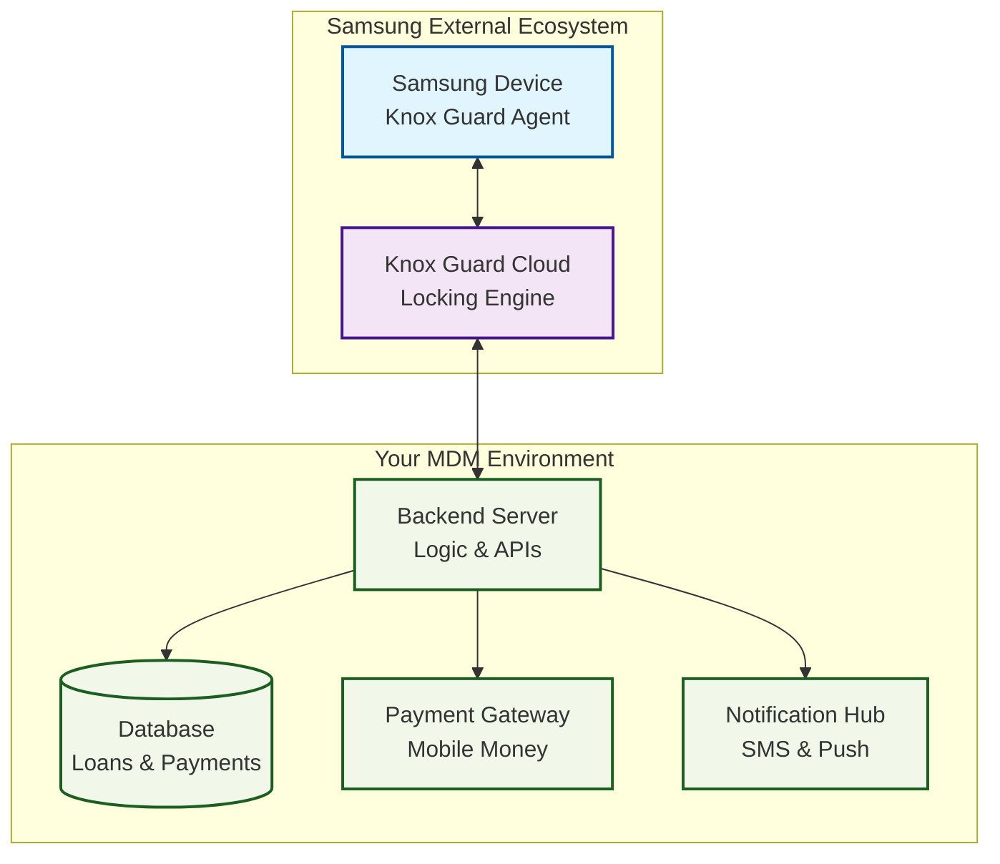
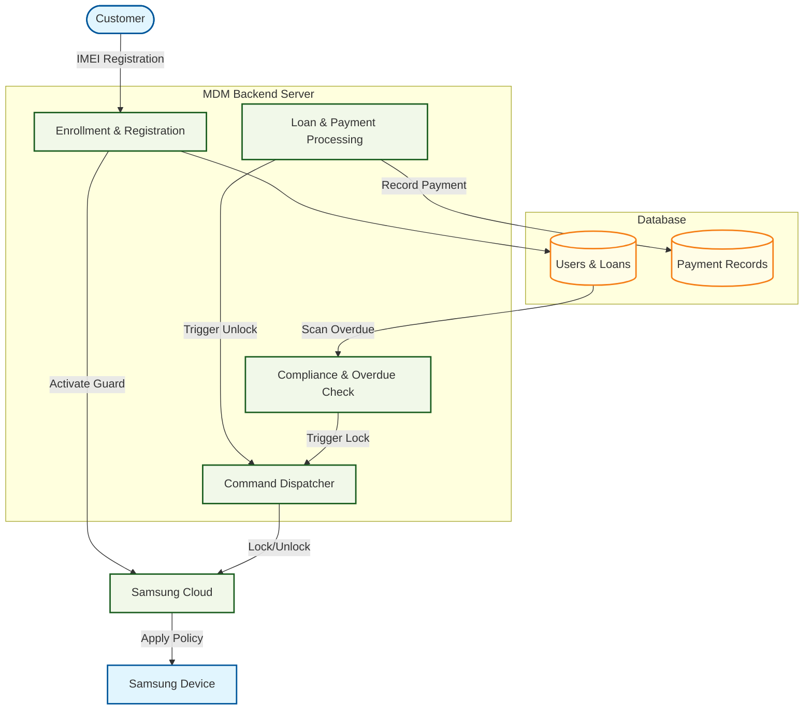

# Samsung Device Lending System via Knox Guard

This document explains in detail how to build a Samsung device lending/leasing system using Samsung Knox Guard, including technical architecture, data flow, database structure, and implementation instructions using Kotlin.

---

## 1. Introduction

Knox Guard is a Samsung cloud service designed specifically for companies that sell or lease devices on an installment payment plan (device financing). It gives you the ability to:

- Remotely lock a device if a customer fails to pay.
- Send custom messages to the lock screen explaining how to pay.
- Monitor device status (network, last seen location, etc.).
- Unlock the device once payments are completed.

There are two types of tenants:

| Type | Description |
|---|---|
| Normal | The customer pays in installments to own the device. If payments are late, the device is locked. |
| PAYG (Pay-as-you-go) | The customer pays a fee to use the device for a certain period (days/weeks). When the time expires, the device automatically locks until they pay again. |

---

## Design Diagrams

Before diving into the details, you can visualize this system through the following professional diagrams:

- [Data Flow Diagram (DFD)](../04_Diagrams/data_flow_diagram.md) - High-level movement of information.
- [System Architecture](../04_Diagrams/system_architecture.md) - Modular relationship between App and Backend.
- [License Activation Sequence](../04_Diagrams/license_activation_sequence.md) - Security handshake process.

---

## 2. Technical Components

### System Architecture Overview

---

## 3. Data Flow and Lifecycle

---

## 4. Implementation with Kotlin

### 4.1 Choice of Backend Framework

For Kotlin, two primary choices for building this backend are recommended:

1. **Spring Boot (with Kotlin):** Industry standard for complex enterprise systems. Provides robust security, database handling (JPA), and built-in task scheduling (CRON).
2. **Ktor:** A lightweight, asynchronous framework native to Kotlin. Excellent for high-performance microservices and simple API gateways.

### 4.2 Database Schema (Core Tables)

| Table | Purpose |
|---|---|
| **Users** | Stores customer identity and contact info. |
| **Devices** | Maps IMEI/Serial to the Knox Guard Device ID. |
| **Loans** | Tracks total debt, paid amount, and payment schedules. |
| **Payments** | Logs incoming transaction references from mobile money. |
| **Lock Events** | Audit trail of every lock/unlock command sent. |

---

## 5. Security and Compliance

- **Secrets Management:** Sensitive keys (Samsung API Secret, Server API Key) must be stored in a secure vault, never in source code.
- **TLS/SSL:** Mandatory for all device-to-server and server-to-gateway communication.
- **Data Privacy:** Adherence to local data protection laws (e.g., Tanzania Data Protection Act) is required when handling customer PII.

---

## 6. Next Steps

1. **Knox Approval:** Contact Samsung for Knox Guard production credentials.
2. **Backend Skeleton:** Initialize the Spring Boot project and connect the SQLite/PostgreSQL database.
3. **Integration:** Implement the payment gateway webhooks.
4. **Automation:** Configure the daily CRON job to check for overdue accounts.
