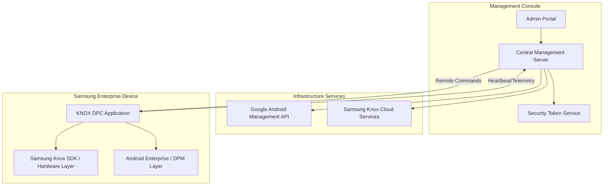

# Master Architecture Specification

## 1. System Overview
The KNOX MDM architecture is built as a single-organization, bank-grade management system. It employs a modular design centered around a "Universal Adapter" pattern to handle multi-layered security requirements.

## 2. Universal Adapter: OEM Abstraction Layer
To ensure long-term maintainability and isolation of manufacturer-specific logic, the system utilizes the `OemCapabilityProvider` interface.

### 2.1 OemCapabilityProvider Interface
This interface defines the contract for all hardware-level operations:
*   `activateLicense()`: Manages manufacturer-specific licensing (e.g., Samsung Knox KLM).
*   `applyHardwareRestrictions()`: Enforces firmware-level blocks on USB, Camera, and Safe Mode.
*   `configureNetworkIsolation()`: Manages hardware-level firewall and APN settings.
*   `setLockdownState()`: Controls Kiosk mode and hardware key restrictions.

### 2.2 Samsung Knox Implementation
The `SamsungKnoxProvider` implements this interface, translating high-level organizational policies into specific Knox SDK calls (e.g., `RestrictionPolicy`, `KioskMode`).

## 3. System Architecture Diagram

## 4. Modular Core Design
*   **Telemetry Engine:** Handles periodic collection and secure transmission of device metrics.
*   **Policy Engine:** Translates server-side JSON policies into local enforcement actions.
*   **Command Processor:** Executes real-time instructions (Lock, Wipe, Update) with guaranteed delivery logic.
*   **Security Manager:** Orchestrates dual-layer protection between Android Enterprise and Samsung Knox.
