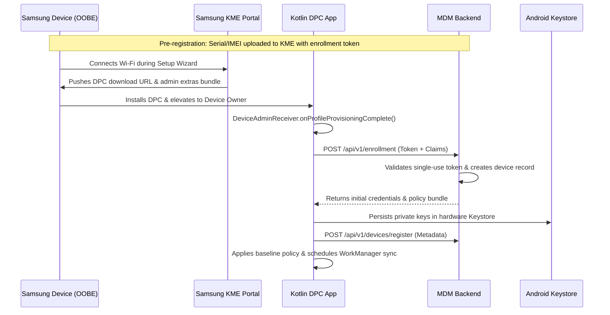
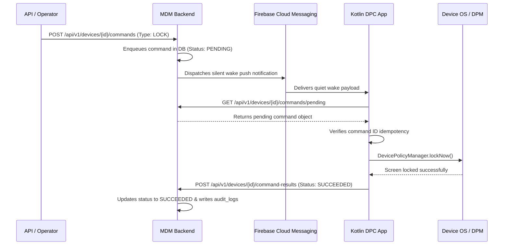
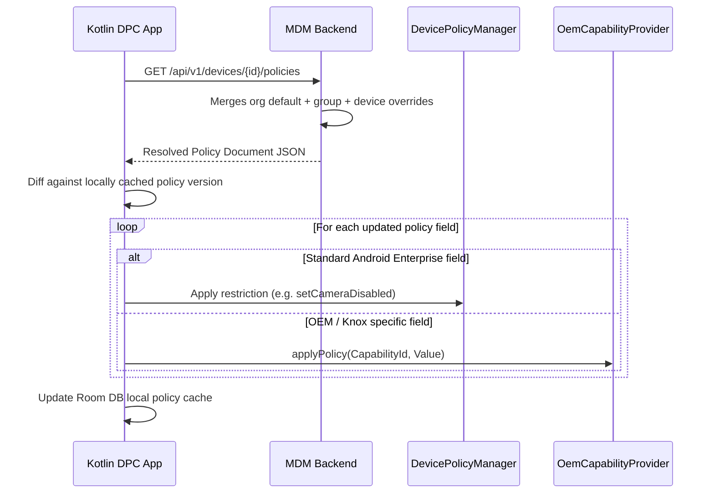
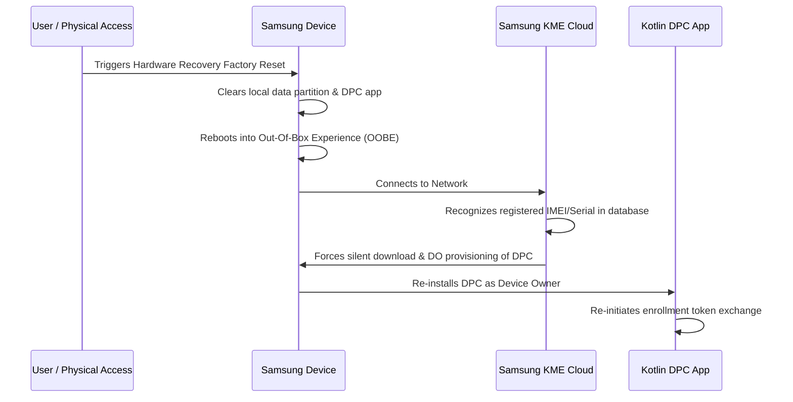

# System Operational Flows

## 1. Device Onboarding & Provisioning Flow (KME / QR)
This diagram details the Device Owner enrollment flow for Samsung devices via Knox Mobile Enrollment (KME) with QR code fallback.

## 2. Remote Command Execution Flow (FCM Wake + REST Pull)

## 3. Policy Resolution & Enforcement Flow

## 4. Factory Reset & Automatic Re-Enrollment Behavior

