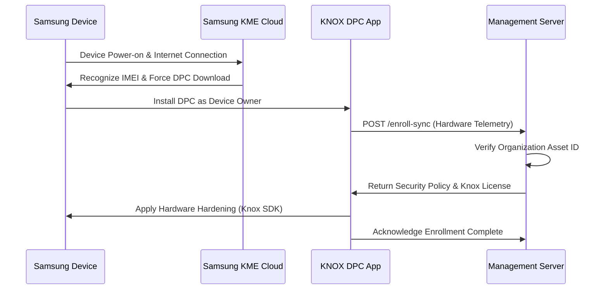
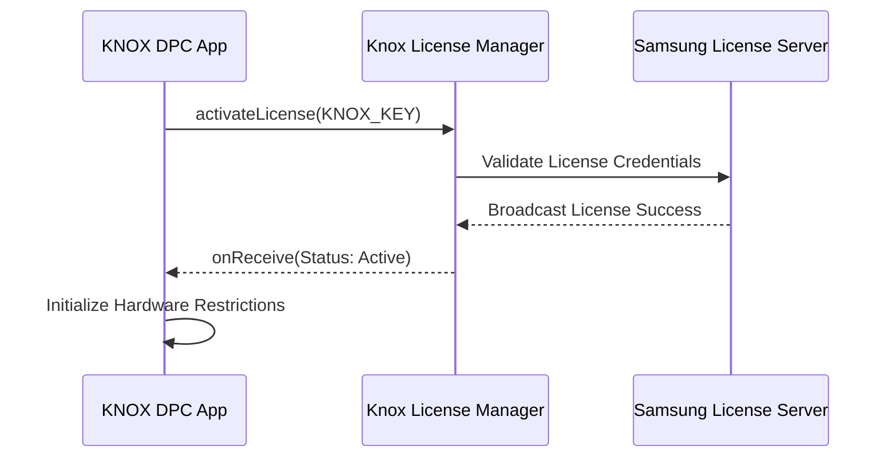
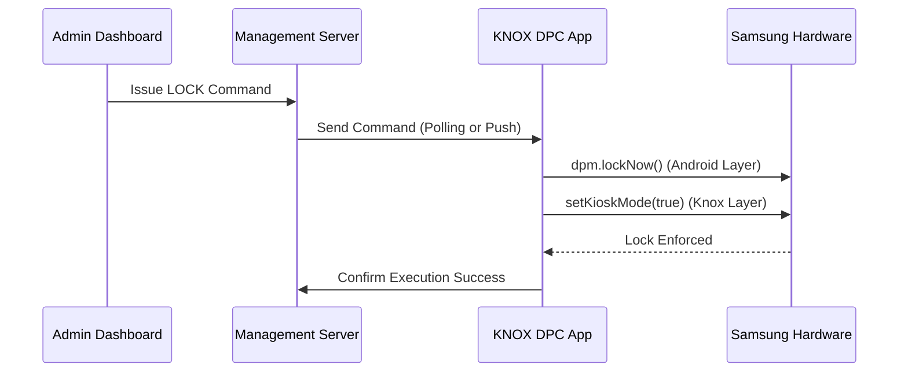
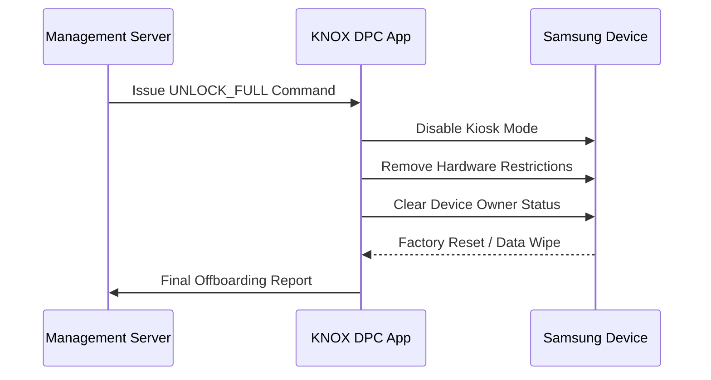

# Operational Flows

## 1. Device Onboarding and Provisioning
This flow describes the zero-touch enrollment process for new Samsung devices.

## 2. Knox License Activation
The activation of the hardware-level security license.

## 3. Remote Hard Lock Execution
The process for enforcing an immediate administrative lock.

## 4. Device Offboarding and Retirement
The procedure for gracefully removing management from an asset.

