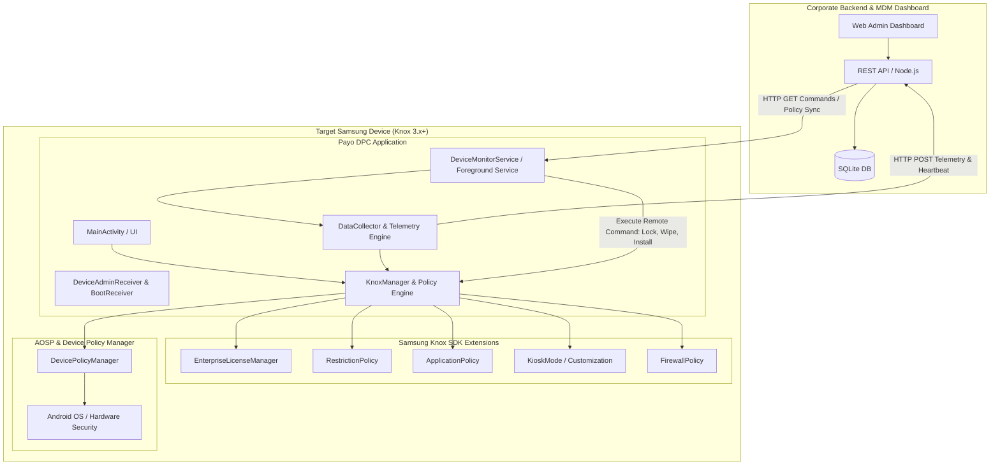
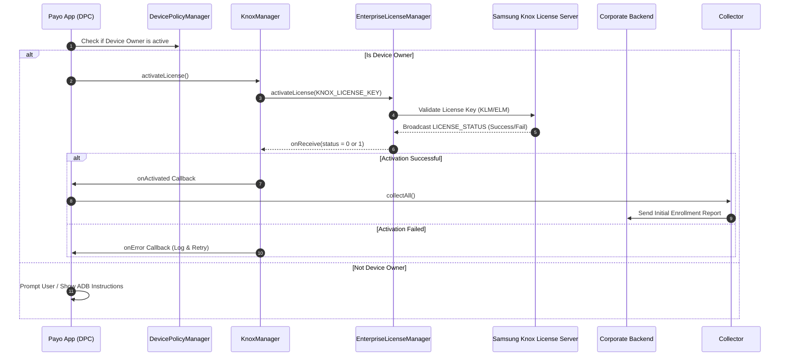
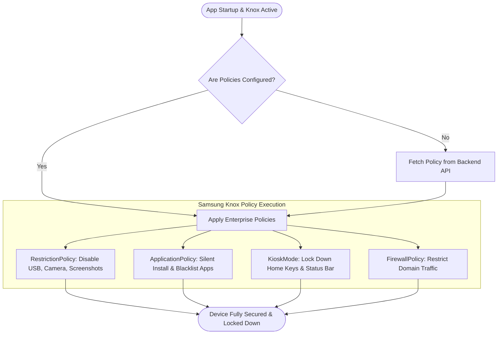
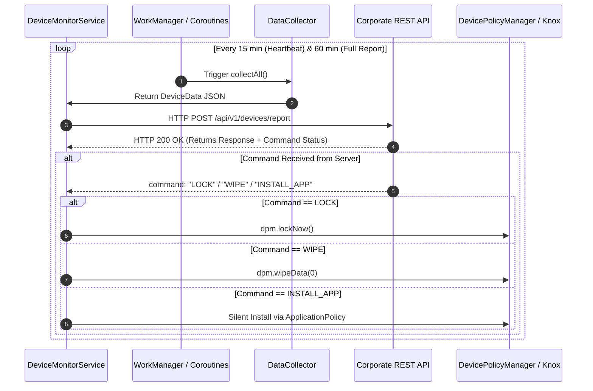
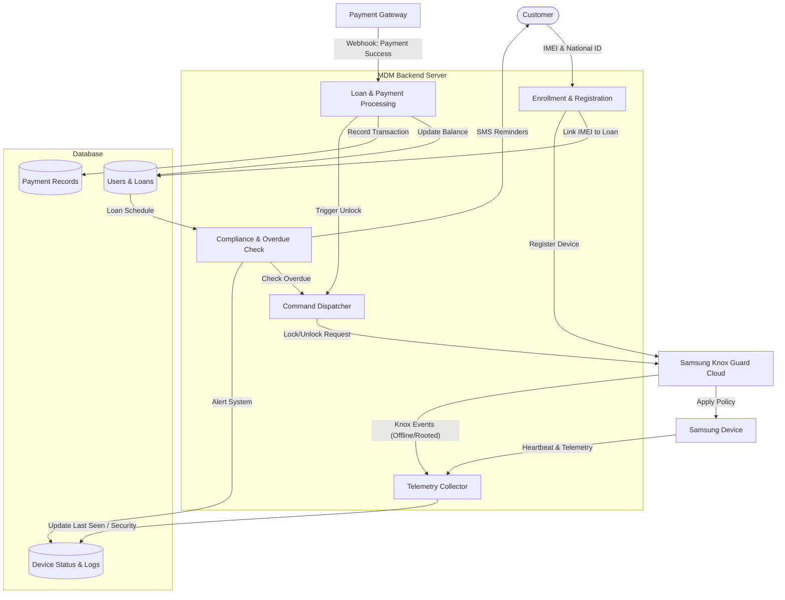

# Samsung Knox MDM Solution: Comprehensive Architecture & Implementation Diagrams

This document provides detailed system architecture diagrams for implementing a production-grade Samsung Knox Mobile Device Management (MDM) solution in compliance with Samsung Knox Documentation.

---

## 1. Overall System Architecture

---

## 2. Knox License Activation & Initialization Sequence

---

## 3. Policy Enforcement & Kiosk Mode Workflow

---

## 4. Telemetry & Remote Command Polling Loop

---

## 5. Data Flow Diagram (DFD)

