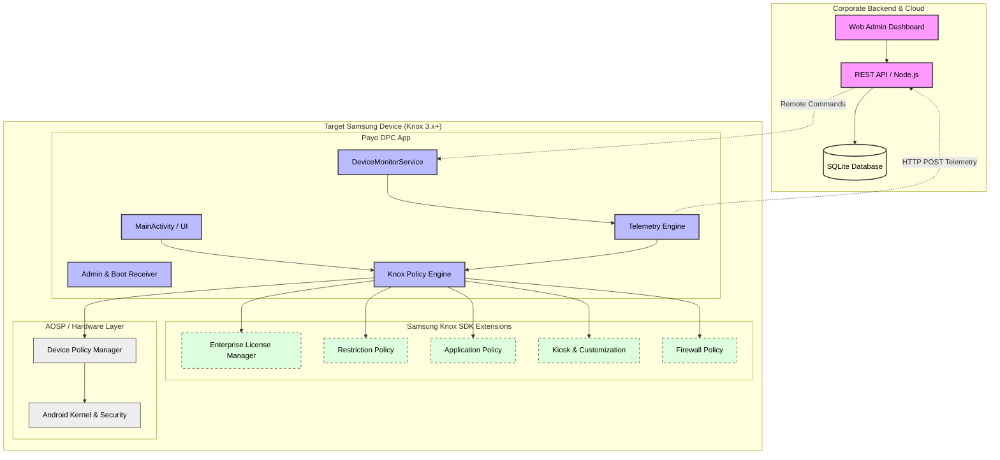
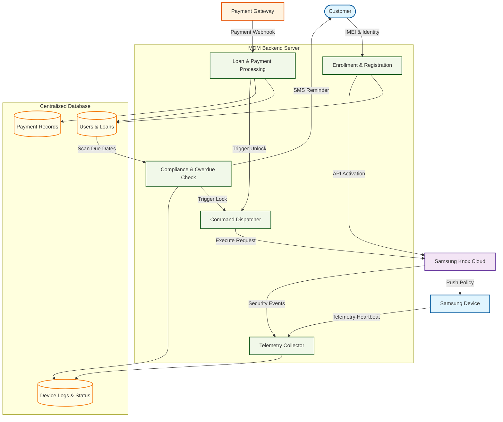
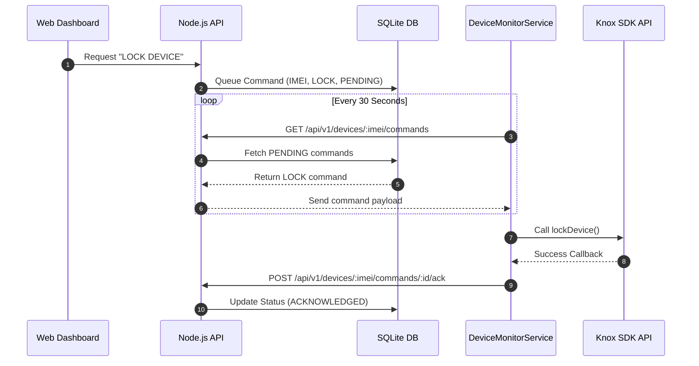

# Knox MDM Solution - Master Diagrams Dashboard

This document consolidates all system architecture, sequence, and workflow diagrams into a single master view. All diagrams are styled for a modern, professional enterprise look.

---

## 1. System Architecture Diagram
[Open Interactive Diagram in Browser](https://mermaid.live/view#pako:eJydVctu2zAQ/JWFggQp6jzaoIeqQAHHcpogdq1GLnpQcliJa5s1RQokldht+u8F9XD8kFOgPBjEcna4s+OlfnupYuT54E015jMYB/cSAODwEL4IlaCAyC4FmSqaCjQmoAmkQhUMJlwI/2DycdIxVqs5+QcXFxf1/uSJMzvz3+eLTqqE0v7B+fn5py0azPOaJEn+m8SweU3CJmw/ybt80QQYmhlqjUsfPsCHV6iVqZmJ6HXm/Rwsafr0WnU7EisWUySVLzdyotFYXaS20ATxvddTOlcaLcElpnOSDI6g52y59x6qZLcCNLNEoWbxD0qgyzIuX2IPvu+XTr7gu+FNfNePxm4DZ/BVMTr9aVqAwWV8HH0bcEsQoMUEDb1xMJa0XA4nJ58d48Y9ZTC4rGIk2Y7mgB55Wmodo56ShQgzU8hpc3B8K9UCLk4Xb99saF4RdPN8gEvSjiLEpYIg7LngBtqt7zfxELnsppY/cruEM/h+48Rgnm8C7ygl/kg6rjp5BJdK2VW0NSUi7aqNq6KHSnKrdB1sTegpISi1SsdjEpSR1UvoyymX7XDXhOFUx2UzQiV4ugPfFlt2vs5rLbYErOrYU147y5qRG144YBTcOisaG8uKXay/sCQNV9LsONMfDOO+tKRzzQ3BgKckDcEQJU6rhhs23/bIWM1Ty5WM1/Z1b1pTunlencbdPBc8xX8l3HJl5nH568auMFZl/FeZ1oq/4pqeUIi42WyTt3padrg/GO4/XNO3H7RStx9SKtl/3FT9b5u7kmnF2ShyRndHUQhncI2aPaEmKIdxx+IgHNbD0fx919xV9ZenWaMorq+AW9KSBBxBRGmhuV224ddVBOFWJ4NwWB6Moi1hWwoPD6GnsgyuhHqq+dem4PTk8/P1eBxCOIrGsJrZ55cHr3zsHOyOMmWpJEPJzHMzb14HvIx0hpx5Pvz27Iyy8qPMaIKFsN6fDnhFztBSn7n3w/NhgsJQBzwsrIqWMvV8sLpwkQoYcJxqzOrwn7/f92dV)
(Detailed analysis of component relationships and server-client communication)

---

## 2. Data Flow Diagram (DFD)
[Open Interactive Diagram in Browser](https://mermaid.live/view#pako:eJyFlWFv2jAQhv/KKVVRKxWpAbK2mTSpELZVK1rUtNqHwAdjX4JVx2a2A2VV//sU4gTaUpVv53vvubuXQzx7VDH0QvAyodZ0QbSF+2gqAQCOjyGxG8FlDhFmXHLLlTR1jgpiTIQZlAY1ZFyI8Aj9LMjwzFitHjE8OveDi6u5C7trzuwi7C2fvr4B5MTimmwcI8uyPp63DPwS+OfnnzKoUCVrCH0MsqAlDIg/uKSfEpZaUTSmYfjZJV61DH8eYO/zKYxVmuS424ThRcvIgovMvzjEaM0eS8stR+fww0k6Ko1VBerZaRiGldF1Jk5jsilQWvhRezcLw9DZWCuSNCGFKWUOv6R6glFlTyXa+lRLolYS4YpTnLUt2nmGhD6iZJCU81yT5aJOGBe16XQSTXZa1CvUs1pafRjXSKvDgfvh7jX207HUSojtGh24w5wbq0klrCZxX8deQS+9VURCB5rd41rCZX64oJ+OVLEUnEiK0IHfK9SsRBgtkD4erhhUFQWRDCJulsTSBerDyiC9R4EFWr2BkRICqVXvpSjZnpsRsWRODH5kZ+KuJx2htJoI/g9ZW7RnaDT005MHg9pABypPzGnV2R3fvq6XnjRm3SFVmn2o7Kcn9RXArcorbmKJLQ/I368E34VaV2WcuruFbhem3s1kfAMduGFYXfVm6kG3+w1i352wvw2j4X4MU+86voFravlqewmuKGlaxrWoWeoPzhdKPTbonhP13qCbeD8PU+9e8zxHDQ9SKNpCBk2vaOhGSiiREJVYbYum0fUdrP8advsa1Uqq/m9KkkkCd1hwyVC7kod20UGtGT8hLS3CHf4t0didH9sfuXOjNAuIleC0MTlqd3DDtbf6E4m2cyQNKQ5cv+D1jA6dIC01txsYr1DadvfAOwOvQF0QzrwQnj27wGL7H8IwI6Ww3ssZeOWSEYtjxq3SXggZEQbPwCOlVclGUi8Eq8vqpRZGnOSaFO755T9XXAfJ)
(End-to-end information movement and external integrations)

---

## 3. Sequence: Remote Command Execution
[Open Interactive Diagram in Browser](https://mermaid.live/view#pako:eJyFk01v2zAMhv8KoVMCOHOH3XQwkFhuYCRN0nldL7koErtosSVPH8GCov99kO10zXyYLpaph+RLSnwlwkgkFIjDXwG1QKb4D8ubvQYA4MEbHZoD2v6/5dYroVquPcxlozRwB894AMbd8WC4lWNuwcUJtYzkxkj89NPBfFeOObaISPW4Vh6BLcZAhfazBEaKYdw9GK28sYN97LDS5neku2/FVn3enuvUz7JsUEfha6zfediT9TZfASu+l3mixJz09ULMsYwsKjwEDQm6ahmsJk/KhKBOIXgnsig0rN8vpNU1tTAvFGe0FvtxBhcJo6fqjuAbpH3Usi2+Q8lal58+p7Mp0KVUNqlT0CT+438q6Ry+OVwUwptlidluwD1Z3uq/wOPIsywaNFKp4iwMJLb/Uhg8eGF377d+KYtcp5LyuoTbi1F/ZZNpj8fA2eBACnev4Axenf6O9y95tq/81KKVKpu8xbpv01EruESrPfXAwmeerzfZ5XbBlwaYkAdKgbbiShMIr8UdsutmQ+MJD7clbAiR0AQoZXx6h8MJrhwmQOCnVRQtCwfulTLD_Qc9Zhtg==)

---

## 4. Advanced Production Backend Life-cycle Model
[Open Interactive Diagrams Dashboard in Browser](https://mermaid.live/view#pako:eNqNVEFv2jAQ_iuWTg0YMGgvlYYBOzbchrbtGLo3S06wWJZybFmS5LhBlv8-bLOwXjptT0vix_fefb6X2ooAasgU8Z4VliS8NaGUbRx1AAA0XesOW7NeddCGEsKC6gMGbQA9rLA3R3UyW9zejsN6NLuZ1S5E_RLWplGsh1IPlSpbeJktAsKB7W1VfR9PIa-MQP0T07zi19hKbRshgZk6Z_dD_2kgC8iywALJewmhhfKuf9shvunx7U1Ih0OoXp_KfcIhVEYPKAVwW8rQffw8-nPZTm9h8_P7H6spnMpCLe7m46vnMxlOSQAu3oenX-8ZXL6BrOoRqV4vj3fung_7NSwDffNANQquE6K5D_8Er0z5gIdyH4Sffv8Ps3_q-L5F8h-eAd3142-exNTafz6UI90jOaR-qh-jf4Q8G_jQAtYTh6oHDA2Z8LzmcB9wLCXp4HxkBrt3D6Bwz8zpr3TxkMDAhhEyCDT6bvxjDrngbwI4gP2D8D5l844f7WdwidH-Do_Q979hPy_AGL-i6L)

*(This links directly to the `sponsa_backend` strict state pipeline transition roadmap diagram).*

---
[Back to Main Documentation](../README.md)
