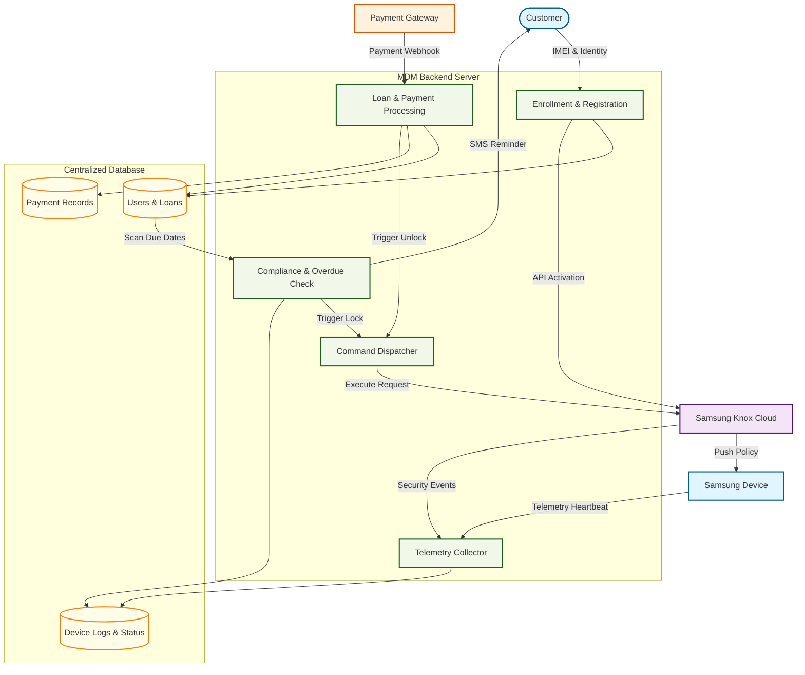

# Data Flow Diagram (DFD)
[Open Interactive Diagram in Browser](https://mermaid.live/view#pako:eJyFlWFv2jAQhv/KKVVRKxWpAbK2mTSpELZVK1rUtNqHwAdjX4JVx2a2A2VV//sU4gTaUpVv53vvubuXQzx7VDH0QvAyodZ0QbSF+2gqAQCOjyGxG8FlDhFmXHLLlTR1jgpiTIQZlAY1ZFyI8Aj9LMjwzFitHjE8OveDi6u5C7trzuwi7C2fvr4B5MTimmwcI8uyPp63DPwS+OfnnzKoUCVrCH0MsqAlDIg/uKSfEpZaUTSmYfjZJV61DH8eYO/zKYxVmuS424ThRcvIgovMvzjEaM0eS8stR+fww0k6Ko1VBerZaRiGldF1Jk5jsilQWvhRezcLw9DZWCuSNCGFKWUOv6R6glFlTyXa+lRLolYS4YpTnLUt2nmGhD6iZJCU81yT5aJOGBe16XQSTXZa1CvUs1pafRjXSKvDgfvh7jX207HUSojtGh24w5wbq0klrCZxX8deQS+9VURCB5rd41rCZX64oJ+OVLEUnEiK0IHfK9SsRBgtkD4erhhUFQWRDCJulsTSBerDyiC9R4EFWr2BkRICqVXvpSjZnpsRsWRODH5kZ+KuJx2htJoI/g9ZW7RnaDT005MHg9pABypPzGnV2R3fvq6XnjRm3SFVmn2o7Kcn9RXArcorbmKJLQ/I368E34VaV2WcuruFbhem3s1kfAMduGFYXfVm6kG3+w1i352wvw2j4X4MU+86voFravlqewmuKGlaxrWoWeoPzhdKPTbonhP13qCbeD8PU+9e8zxHDQ9SKNpCBk2vaOhGSiiREJVYbYum0fUdrP8advsa1Uqq/m9KkkkCd1hwyVC7kod20UGtGT8hLS3CHf4t0didH9sfuXOjNAuIleC0MTlqd3DDtbf6E4m2cyQNKQ5cv+D1jA6dIC01txsYr1DadvfAOwOvQF0QzrwQnj27wGL7H8IwI6Ww3ssZeOWSEYtjxq3SXggZEQbPwCOlVclGUi8Eq8vqpRZGnOSaFO755T9XXAfJ)

A detailed flow of information between the Customer, Backend Server, Payment Gateway, and Samsung's Knox infrastructure.

---
[Back to Master Dashboard](Master_Dashboard.md) | [Back to Main Documentation](../README.md)
