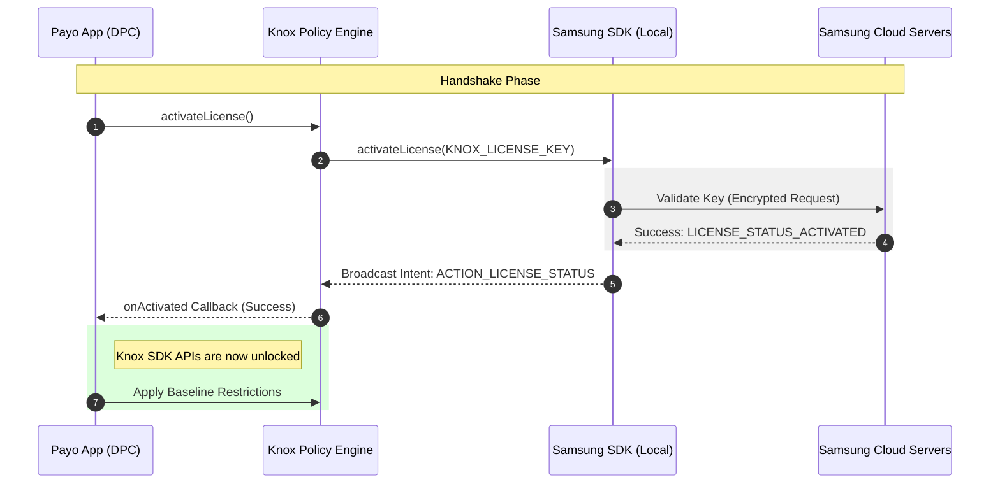

# Knox License Activation Handshake
[Open Interactive Diagram in Browser](https://mermaid.live/view#pako:eJxtU9Fq2zAU/ZWLnlxwYIT1xQ8GNzEsxElDlZUVCuFGunFEbEmT5Gym9N+HEmdLl/rBSPI59x6fo/vGhJHEMmCefnakBU0V1g7bVw0AgF0wumu35M57iy4ooSzqAIW1gB5W2JvTOpmuJne3sLk2vxe1i9C4hJVplOih1LXSdAsvq0WEcmx9p2vg0zkklRHYfFKaV/waO2lMJ4GTO5Lzr/qMX5pAYI7kosY0UjL4hlr6PR4IVnv0g4jC2lGeD2ozQBHUEQNVSpD2lAzth++jPC+rxS1qvnz8salmk3LJy828fLm7yHAkArh6m4y/fknh8hqKxqesFqM8P8l7xkZJDARz6iEptXC9DSThKSbkwxWJV3x0kcI7Icj7DC7t+bpYf+ebYrKePRfrcnqmkZYXTbHl9S8/OINSoA8w04F0yCByH5ebjxU/GjHK88LaDIwuBi8kTLBptigOkAyiPrFhHB24v09hPL624RSXU/U+gNnFTLLzrYn3oFjNPKAj0OYXdLox4kDyH/W/AAtrmx4e0FOjNMET+eCUCMpo/9cJlgJrybWoJMvgjYU9tadhkLTDrgnsPQXW2RhGKVUwjmWww8ZTCiyOBu+1YBkE18WTM3CYn+H4/Q9/ghM0)

Detailed sequence of the license validation process between the Payo DPC App and the Samsung Enterprise License Management (ELM) servers.

---
[Back to Master Dashboard](Master_Dashboard.md) | [Back to Main Documentation](../README.md)
