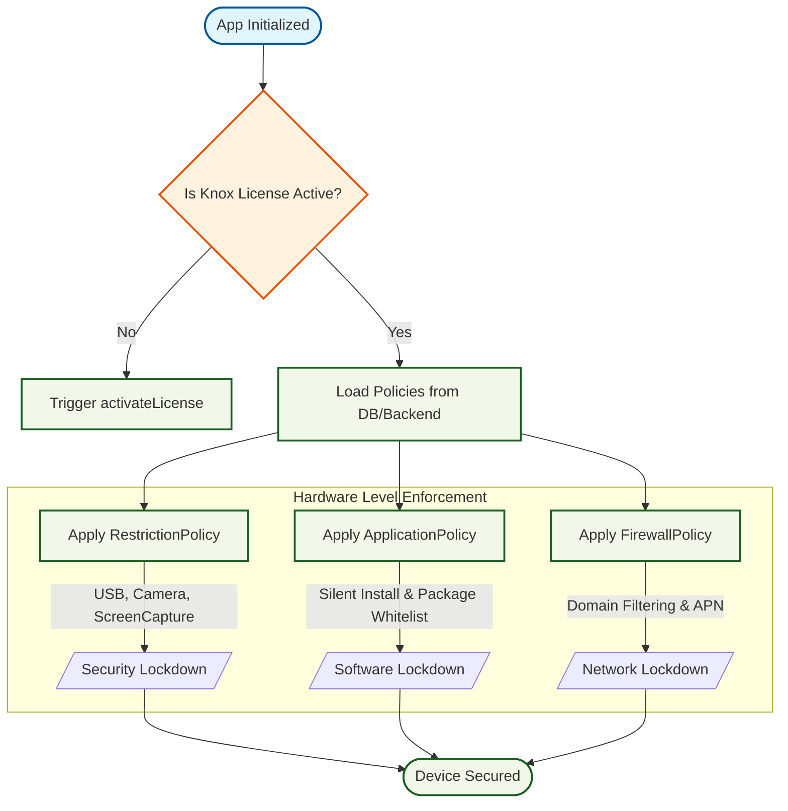

# Runtime Policy Enforcement Workflow
[Open Interactive Diagram in Browser](https://mermaid.live/view#pako:eJyV1G1P4kAQB/CvMqnReAmEB4One8ldUDSYI8RYL+RSfTHsTmHDdre3nYKc8btf+gBynMZcX5B2uvNj5w/tcyCdokBAEBu3knP0DPeDBwsAcHgIIa+NtrPqWhrMsgHFwF7PZuQh1saIA+rEvZgaGXu3IHHQ7vQ+n0/ry+ZKK56Lbvr0Zc+Qc5KLWojj+ITaW4FOe512+0MBJWtnN0QnPqPzLdGZ9qj7MUFWjZ2i7TZoSq+DyNPuWffsLaNSQkbPx1E/TeHGatZo9G9Sj5+EEJuAms2vcFkM2pesl/R8k8F3655gpCXZjKAqf3sRQpR5bOidHmg24SEYu4eg1O7oV04Zl/ewmD+6r7+riGOJTLX9KISoEnqH/ElZbV4Ty/mtM1quo5FDBeW5pgxi7xIYXLQuUC7Iql2zUndaS6qfpmYdksy95nURjVnDHWXsddlWrdzf2ptIP02zGig+tcT/BMbEK+cXtXGtPa3QmH+Bisjy6cxjOocrGzsvKSHLEA3RqxV6ghEtyezee6zaiuOvmatsf4QXDbjEhDw2IJSeyF5iyrmnOvLhpBO1tj0jJxfKrWxrXy1CqMRQm2JHNzZjNAaO4BblAmcEk7lmMjrjrdyNWqGLudr3e/K4SqfCBy5BbeFaGyav7QyOoH873oInUWuzfN8jqzYJDied+h+Kan0cDWipJUE5Y/1U7P5kw0n3dfWmdPJaChoQJOQT1CoQ8BzwnJLyNaUoxtxw8NKAIE8VMl0pzc4HAmI0GTUgwJxduLYyEMA+LyrVwoHGmcekLr/8Afx1p9I==)

This logic flow illustrates how the Knox Policy Engine determines which enterprise restrictions to apply during app startup or backend synchronization.

---
[Back to Master Dashboard](Master_Dashboard.md) | [Back to Main Documentation](../README.md)
