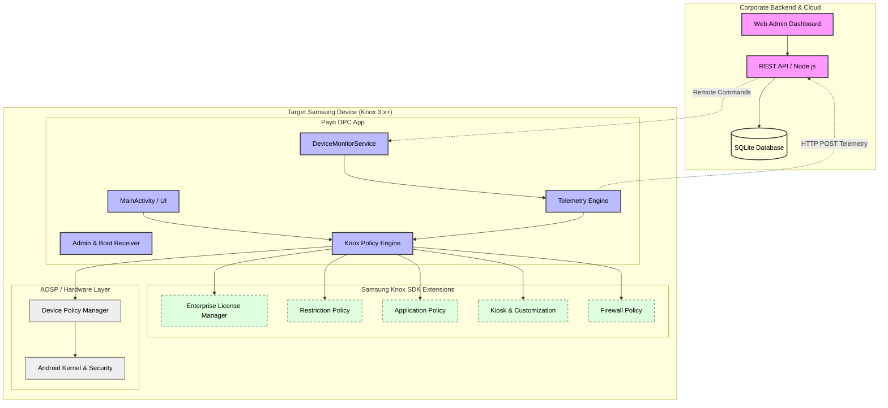

# System Architecture Diagram
[Open Interactive Diagram in Browser](https://mermaid.live/view#pako:eJydVctu2zAQ/JWFggQp6jzaoIeqQAHHcpogdq1GLnpQcliJa5s1RQokldht+u8F9XD8kFOgPBjEcna4s+OlfnupYuT54E015jMYB/cSAODwEL4IlaCAyC4FmSqaCjQmoAmkQhUMJlwI/2DycdIxVqs5+QcXFxf1/uSJMzvz3+eLTqqE0v7B+fn5py0azPOaJEn+m8SweU3CJmw/ybt80QQYmhlqjUsfPsCHV6iVqZmJ6HXm/Rwsafr0WnU7EisWUySVLzdyotFYXaS20ATxvddTOlcaLcElpnOSDI6g52y59x6qZLcCNLNEoWbxD0qgyzIuX2IPvu+XTr7gu+FNfNePxm4DZ/BVMTr9aVqAwWV8HH0bcEsQoMUEDb1xMJa0XA4nJ58d48Y9ZTC4rGIk2Y7mgB55Wmodo56ShQgzU8hpc3B8K9UCLk4Xb99saF4RdPN8gEvSjiLEpYIg7LngBtqt7zfxELnsppY/cruEM/h+48Rgnm8C7ygl/kg6rjp5BJdK2VW0NSUi7aqNq6KHSnKrdB1sTegpISi1SsdjEpSR1UvoyymX7XDXhOFUx2UzQiV4ugPfFlt2vs5rLbYErOrYU147y5qRG144YBTcOisaG8uKXay/sCQNV9LsONMfDOO+tKRzzQ3BgKckDcEQJU6rhhs23/bIWM1Ty5WM1/Z1b1pTunlencbdPBc8xX8l3HJl5nH568auMFZl/FeZ1oq/4pqeUIi42WyTt3padrg/GO4/XNO3H7RStx9SKtl/3FT9b5u7kmnF2ShyRndHUQhncI2aPaEmKIdxx+IgHNbD0fx919xV9ZenWaMorq+AW9KSBBxBRGmhuV224ddVBOFWJ4NwWB6Moi1hWwoPD6GnsgyuhHqq+dem4PTk8/P1eBxCOIrGsJrZ55cHr3zsHOyOMmWpJEPJzHMzb14HvIx0hpx5Pvz27Iyy8qPMaIKFsN6fDnhFztBSn7n3w/NhgsJQBzwsrIqWMvV8sLpwkQoYcJxqzOrwn7/f92dV)

This diagram analyzes the structural relationships between the Android DPC App, the Samsung Knox SDK layer, and the remote management backend.

---
[Back to Master Dashboard](Master_Dashboard.md) | [Back to Main Documentation](../README.md)
