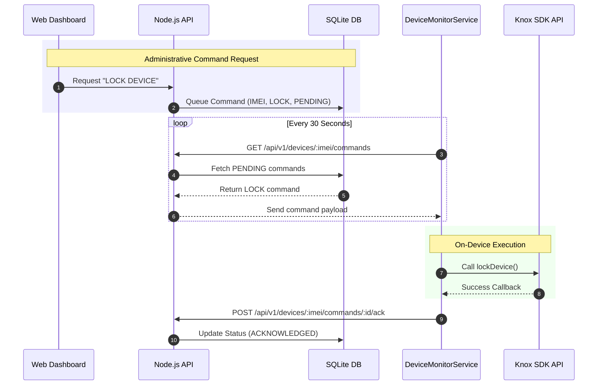

# Telemetry and Remote Command Sequence
[Open Interactive Diagram in Browser](https://mermaid.live/view#pako:eJyFlE1z2jAQhv/Kjk5kxtTpBxcfPAPIZRgIkLptLlyEtAkqtkT1wZDJ5L9nZJkSajr1wZblZ3ff3dX6hXAtkGRALP72qDhSyZ4Mq9cKAIB5p5WvN2ji+54ZJ7ncM+VgKGqpgFl4wA1QZrcbzYzociPGd6hEIBda4IdfFoaraZejo4CU93PpEOioC5RoDpJjoCiG1Z1W0mnT7ncNZkofA908SzqLcSNnkDswT5vepy+3CcTbYHATP4ZroR2CPqCJiSZAR1lcSusMc/KAMNZ1zZSAb6F21p2NG66f523u2YmANZkvxzOgxc/puFiTs0VL9vM8xLn36M/ue9O7YppAsExgVSzodDFplaISp4wqrfdQHNA8w+dbKJFrJew5QFul96ImxXdI2V6mh4+paCpq00zWKFMeI9t/6fuKjm9PUqBL01H/MnvnjWoSOMFdz/08bzVmUIYD05KwZ8+VZqKT8F8tHAyaPl5tYes4aY5CBkvVjycIiiNy76RW1woV4TGrKqg030WT3rsAM6WPl7o952htY7NhfNfRfKULq2X5vzakmRTpH3eXrfixF8whlI45b6E3HM8Wy4d5QScFvSEJkBpNzaQgGbwQt8W6GXaBj8xXjrwmQHzjoBBhlEgGj6yymAAJo18+K04ycMaHnQi2/4d2+/UN/xxXEA==)

This sequence diagram details the background synchronization process between the DeviceMonitorService and the Node.js API, including command queuing and acknowledgement.

---
[Back to Master Dashboard](Master_Dashboard.md) | [Back to Main Documentation](../README.md)
