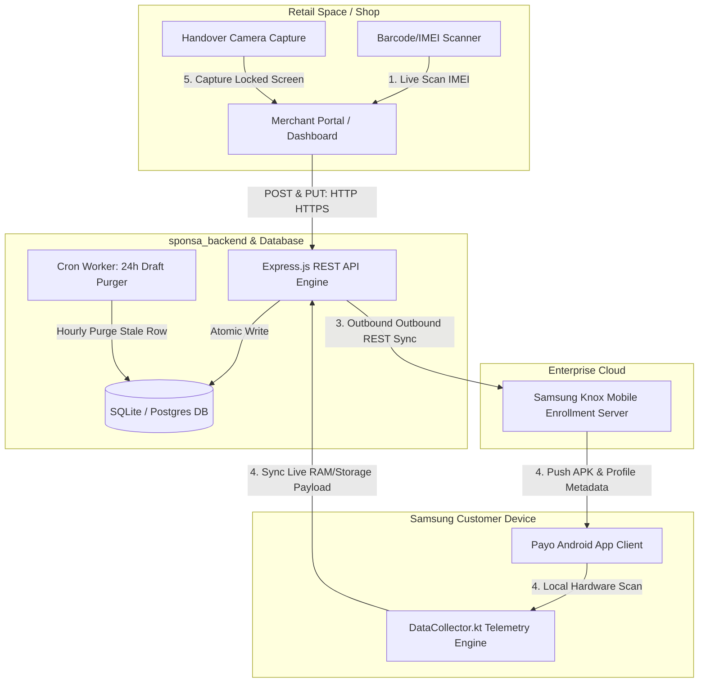
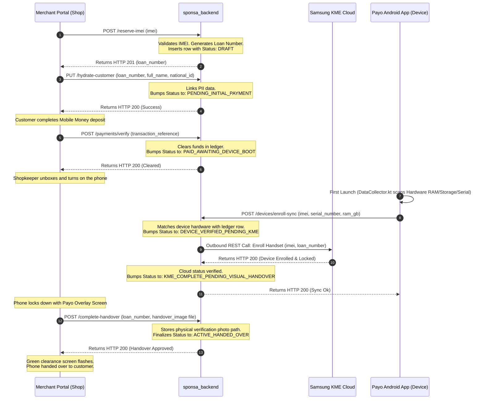
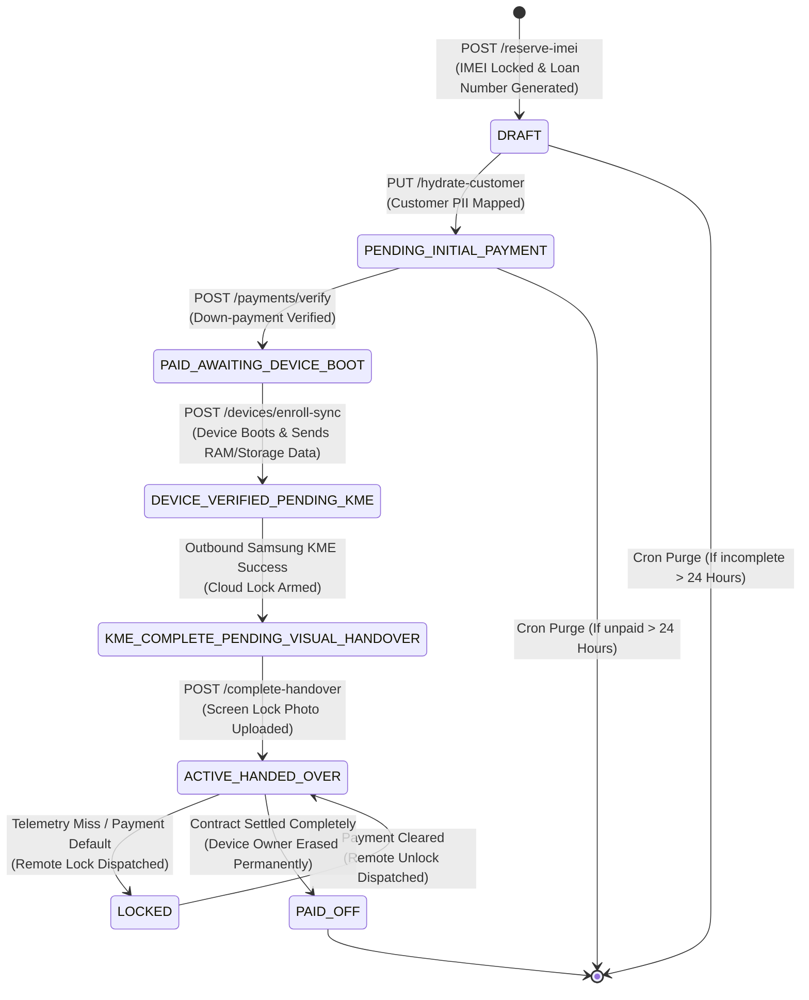

# Knox MDM & FinTech System Architecture Diagrams

This document contains visual architectural blueprints and sequence flowcharts using **Mermaid.js**. These diagrams model the complete multi-step validation loop, database state changes, and cross-platform handshakes between the **Merchant Portal**, **sponsa_backend**, **Samsung Knox Cloud**, and the **Payo Android Client App**.

---

## 1. End-to-End System Architecture
[Open Interactive Diagram in Browser](https://mermaid.live/view#pako:eNptUctOwzAQ_JWVTxwQCfGDoA4SQuIAnpUiVby0STZNsYvX9toUiH_HThpA6mFvOzOznvXubpIxK0EszU8N-KypwtbhnmoAAOzc1p3bmfW2A9pICXmg_F4gD6vv9XEZSZeD23twuxCvi9BFyC_DMNKloUt56Sbu6w7D3Lte1UDH7bBUgm_fMU0pfo211KZRwE4XonvXf_pIEwgskVwU6HscXAs13Z_6CO96fHwI6bCH6vRDmQ9wBLXEgEoB4qbyof_69d6fy2Z6izrfvX6ZbeGmLvTidj68f77IMKIGOHw6DN8_Urh-BEVdI6v6kNc36W-gUZQDwp9yCEpNOm8FCX8CIfpwQeIaf50m_4bI2WZw8Fof39p8_qEup8vFeGkK6o7mR-ph85G9GgE8wwbLgZIDg_GscH6u0HBAKE8LaxOgdy96PmCCVbNFsc_mE-v_qTAenzrwExRNuP_L7BgmXnhf-g6SxcS92fL7KDo_v7fBBscwUf_3Fv0bAnM3wToS-w)

This diagram illustrates how all four components interact, emphasizing data protocols and security boundaries.

---

## 2. Strict Sequential Handshake Flow
[Open Interactive Diagram in Browser](https://mermaid.live/view#pako:eNqFU0Fv2zAM_SuCTh0YMMb6IhgG7NhwG9ptw9C9WbKIsWwpsywpctwgy38fKasdO8uWB0uizseHjzylVtoIC64C1nllScU7E0bF5tEEAMBFFp0tCzL6XKNLSgD_V3mvlJf6b8FpGQoHru_B7SK8NkGfILv0_YCOW2FmBO_swlXv66bYpU-O6rYmZ2XbxF7Zt7FX-uVw_9onZ7p3-2y7Vttb00v9Nn_6SJ7uPf-D6t6UvW80NqWGb7G7z7G_79F_rOnuPscuFep9S2H-b-79D_WvFez_y_7n5ZLvSrrM52T4lZ7ZshjU8_X7fD7fnGSoE_b_0gYg_P_Y5UAm96Uv2P_rM9_p_X8vU9m7YpXmY3C-W0-bW-p0vJnNF8GgbvO6ox62bM-Lg4RlgVfowKscGOzvIeeXEg72iPC0MDYBMvti-oYJpuxZFPlivbH-nyLD8bIBAUGxh_O32SJM_PDY8N_Aonb77gX-C6PUy_4wOn2H_NofzshgfoLhBzeCkwA)

This sequence blueprint traces a single transaction lifetime, charting the operations from the initial box scan to final handset handover clearance.

---

## 3. Database Loan State Machine Transitions
[Open Interactive Diagram in Browser](https://mermaid.live/view#pako:eNqNVEFv2jAQ_iuWTg0YMGgvlYYBOzbchrbtGLo3S06wWJZybFmS5LhBlv8-bLOwXjptT0vix_fefb6X2ooAasgU8Z4VliS8NaGUbRx1AAA0XesOW7NeddCGEsKC6gMGbQA9rLA3R3UyW9zejsN6NLuZ1S5E_RLWplGsh1IPlSpbeJktAsKB7W1VfR9PIa-MQP0T07zi19hKbRshgZk6Z_dD_2kgC8iywALJewmhhfKuf9shvunx7U1Ih0OoXp_KfcIhVEYPKAVwW8rQffw8-nPZTm9h8_P7H6spnMpCLe7m46vnMxlOSQAu3oenX-8ZXL6BrOoRqV4vj3fpr7-Rgw6_4b4ZgFIN11mB_IdXon_GRLgLwU-6eIffv_F_XST_CskH7_j2ssnnb2o6nU8X6pGe0TxSD9W_wR8K_m0EaAnD0QOFA87-XHA-C7gXEPbyPDAGWvdw-gcM_M6a908ZDAwIYRMgg0-m78Yw654G8COID9g_A-ZfOOH-1ncInR_g6P0Pe_YT8g)

This state transition flowchart enforces the linear state movement that the backend engineer must implement. It guarantees no state can be bypassed.

---
*Nexivo Enterprise Engineering Standards - 2026*
